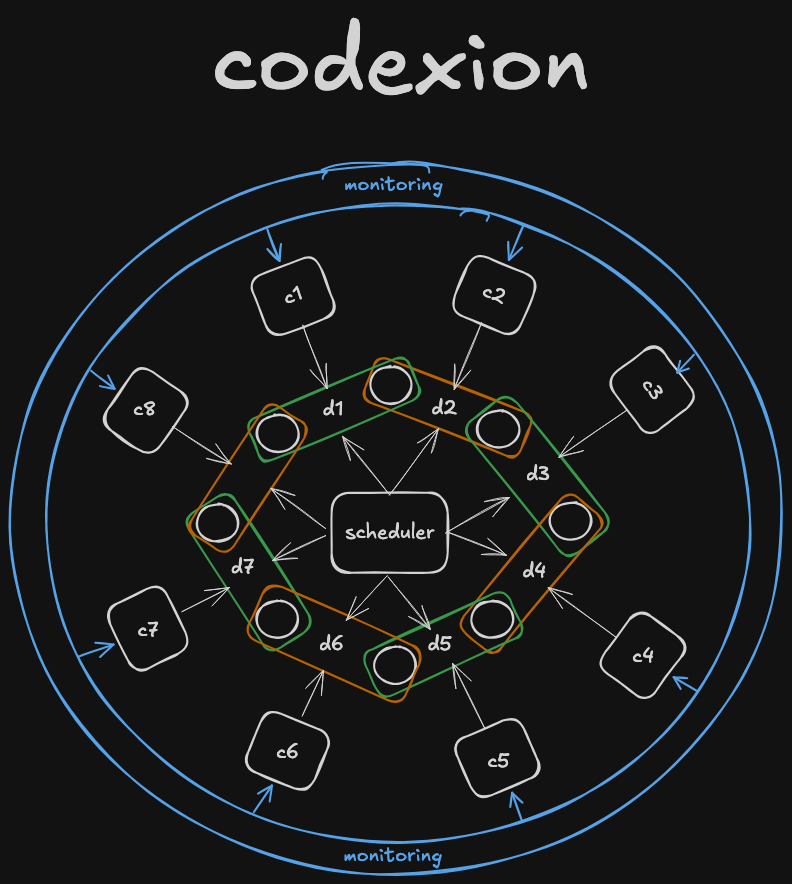
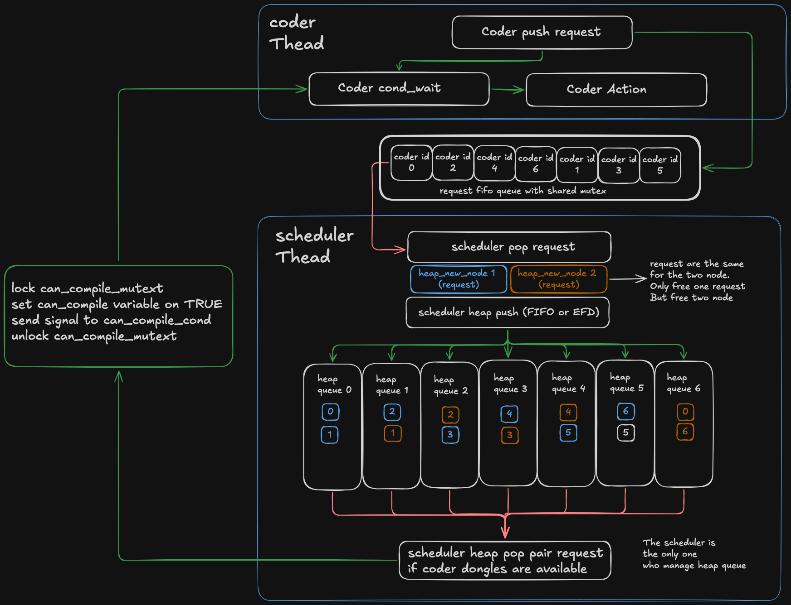

*This project has been created as part of the 42 curriculum by cebouhad*




## 📖 Description


## ⚙️ Instructions

### Compilation


### Test

Running  test with default param (unit test + memory check = off):

```bash
make test
```

Running test unit + memory check:

```bash
make test TYPE=unit MEMORY_CHECK=1
```

### Usage

### Cleaning

## 🏗️ Project Structure

## Scheduler / coder relationship



## 💵 Bonus

## 📚 Resources

### heap queue

https://www.youtube.com/watch?v=HqPJF2L5h9U


## 🤖 AI Usage

## 🎯 Learning Objectives
